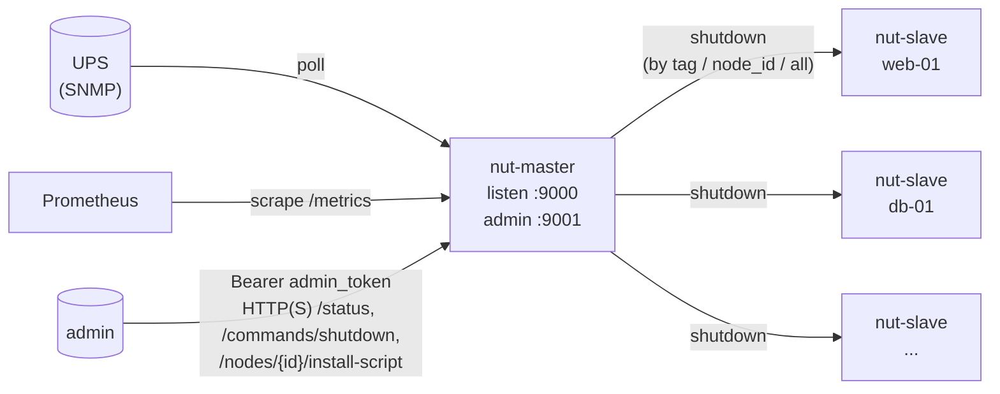

# nut-server

[](https://github.com/riofutab/nut-server/actions/workflows/build.yml)
[](https://github.com/riofutab/nut-server/releases/latest)
[](LICENSE)
[](go.mod)

> **Lightweight NUT-style UPS shutdown orchestrator for homelabs and small fleets.**
> 轻量 NUT 风格 UPS 关机编排,适合 homelab 与小型机房:master 通过 SNMP 轮询 UPS, slave 主动注册并在策略命中时执行关机, 全程 mTLS / Bearer token / Prometheus 可观测、`.deb` / `.rpm` / `.tar.gz` 三件套发布。

## Quick start

在 master 主机一行装好(`--token` 是 enrollment token,slave 首次注册时使用):

```bash
ENROLL_TOKEN=$(openssl rand -hex 24); echo "$ENROLL_TOKEN"   # 记下来,装 slave 时要用
curl -fsSL https://raw.githubusercontent.com/riofutab/nut-server/master/scripts/install-online.sh \
  | sudo bash -s -- --role master --version latest -- \
      --token "$ENROLL_TOKEN" \
      --admin-token "$(openssl rand -hex 24)" \
      --snmp-target 10.0.0.31
```

在每台需要被关机的 slave 上装好(注意 `--master-addr` 改成你 master 的地址)。token 通过文件传入,不出现在命令行参数里:

```bash
sudo install -m 0600 /dev/null /root/nut-enroll-token
printf '%s\n' 'your-enrollment-token' | sudo tee /root/nut-enroll-token >/dev/null
curl -fsSL https://raw.githubusercontent.com/riofutab/nut-server/master/scripts/install-online.sh \
  | sudo bash -s -- --role slave --version latest -- \
      --node-id slave-01 --master-addr 10.0.0.10:9000 --token-file /root/nut-enroll-token
```

slave 首次注册后,master 会给它签发专属 token,之后 enrollment token 不能再以这个 `node_id` 注册。也可以在 master 上用 `POST /nodes/{node_id}/install-script` 生成带专属 token 的装机脚本,见 [docs/master.md](docs/master.md)。

`dry_run` 默认开启,先把链路跑通确认 `/status` 看到 slave 在线再切真实关机。详细配置看 [docs/master.md](docs/master.md) / [docs/slave.md](docs/slave.md);版本升级看 [docs/upgrade.md](docs/upgrade.md)(v0.6.0 的配置有破坏性变更)。

## Architecture



每台 slave 通过 TCP/TLS 长连接挂在 master 上,断线自动指数 backoff 重连;master 收到 UPS 触发条件后按多策略合并出 target 集合,并发下发 shutdown,等远端 `executed` 回执后(可选)再关本机。

仓库包含 master / slave 两个二进制、示例配置、systemd unit、安装脚本、Linux amd64/arm64 构建脚本,以及 GitHub Actions 工作流:每次 `v*` tag 都会自动生成 `.tar.gz` / `.deb` / `.rpm` 包并上传到 GitHub Release。最新版本是 [v0.6.0](https://github.com/riofutab/nut-server/releases/tag/v0.6.0)。

UPS 读取由 `snmp.profile` 决定 OID:默认 `ups-mib`(RFC 1628 UPS-MIB),另有 `apc` / `cyberpower` / `eaton`;单项 OID 可用 `snmp.on_battery` / `snmp.charge` / `snmp.runtime` 覆盖。

## Table of Contents

- [Features](#features)
- [项目结构](#项目结构)
- [快速开始](#快速开始)
- [配置说明](#配置说明)
- [TLS / mTLS](#tls--mtls)
- [dry-run](#dry-run)
- [状态恢复](#状态恢复)
- [构建 Linux 发布包](#构建-linux-发布包)
- [systemd 部署](#systemd-部署)
- [master 本机自关机](#master-本机自关机local_shutdown)
- [UPS 轮询可观测性](#ups-轮询可观测性)
- [Prometheus 指标](#prometheus-指标)
- [开发辅助](#开发辅助)
- [路线图](#路线图)
- [Security](SECURITY.md) · [Contributing](CONTRIBUTING.md) · [Upgrade Notes](docs/upgrade.md) · [Changelog](CHANGELOG.md)

## Features

### 协议与连接
- **TCP 长连接 + 行式 JSON 协议**: token 注册, 握手 / 空闲读超时, 写 deadline; 重连用**指数 backoff + ±20% jitter**, 抖动主节点不会被打爆
- **TLS / mTLS**: master 与 slave 都可选启用; 内网可 `tls.disabled: true` 显式关掉
- **per-node token** (v0.6.0+): slave 首次用 `enrollment_tokens` 注册后,master 给该 `node_id` 签发专属 token,只保存其 SHA-256;`enrollment: closed` 后新 `node_id` 无法注册,单个 token 可吊销
- **token 比较**: 两边先做 SHA-256 再对所有候选做恒定时间比较,不泄漏匹配前缀和长度

### UPS 与关机决策
- **SNMP UPS 轮询**: `snmp.profile` 预设 OID(`ups-mib` / `apc` / `cyberpower` / `eaton`),可逐项覆盖;支持 SNMP v1 / v2c / v3 (v0.6.0+);可选 `log_ups_status: true` 把成功轮询也写 journal
- **多策略组合关机条件** (v0.3.0+): `shutdown_policies` 列表, 内部 AND / 多条 OR, target 取并集, reason 拼接
- **防抖与失联兜底** (v0.6.0+): 策略 `duration` 要求条件连续满足一段时间才触发;`when.ups_unreachable_for` 在断电期间 UPS 失联时触发
- **断电周期 (episode)** (v0.5.2+): 策略只在 UPS 走电池时评估;同一次断电里后命中的策略并入同一条命令(先关 dev、续航低时再关全部),失败节点每 30s 重试,市电恢复后结束
- **关机编排**: 按 `node_id` / `tag` / `all` 定向下发, `command_timeout` 强制超时, 状态文件恢复
- **master 本机关机**: 远端节点完成后再关本机, `max_wait` 兜底 + `emergency_runtime_minutes` 紧急阈值 + 断电期间 UPS 失联超过 `unreachable_after` 时紧急关机

### 管理与可观测
- **管理 API**: `/status`、`/commands/shutdown`、`/commands/reset`、`/nodes/expect`、`/nodes/{id}`、`/nodes/{id}/token`,全部要求 `Authorization: Bearer <admin_token>`
- **HTTPS admin** (v0.6.0+): 配置 `admin_tls` 后 admin 口改为 HTTPS(最低 TLS 1.2)
- **内嵌只读状态页**: `GET /` 直接看 UPS、节点表、活动命令;`admin_token` 仅放 sessionStorage
- **节点目录**: 每节点 `first_seen` / `last_seen` / `tags` / `hostname`,可预登记"预期但还没上线"的节点
- **一键装机 endpoint** (v0.6.0 起为 POST): `POST /nodes/{node_id}/install-script` 为该节点签发专属 token 并返回装机脚本,master 开了 TLS 时脚本内嵌 CA
- **Prometheus `/metrics`** (v0.3.0+): master admin 口默认开放 (绑回环保护);slave 可选 `metrics_listen_addr` 启用
- **结构化日志**: `log/slog` JSON handler 输出 `command_id` / `node_id` / `peer` 等字段

### 部署与运维
- **发布产物**: `.deb` / `.rpm` / `.tar.gz` × amd64 / arm64,附带 `SHA256SUMS`
- **`install-online.sh`** 自动检测 `apt` / `yum` / `dnf` 选包格式;`--` 后传 role-script 参数会自动走 tar.gz 路径预填配置
- **配置严格校验** (v0.6.0+): 未知字段直接报错;`nut-master -check-config` / `nut-slave -check-config` 只校验配置和关机权限,安装与升级脚本在启动服务前都会跑一遍
- **systemd 沙箱化**: master 走 `User=nut-server`,`ProtectSystem=strict`、`ProtectHome`、`PrivateTmp`、`RestrictAddressFamilies` 等全套
- **状态文件原子写**: tmp + `fsync` + rename,`0600` 权限,崩溃中途不会留半截文件
- **优雅停机**: SIGTERM / SIGINT 通过 `context.Context` 传到所有 goroutine,systemd stop 不触发 timeout
- **e2e 集成测试套件** (v0.3.0+): `internal/e2e/` 包 + `e2e` build tag,在 loopback 上真的拉起 master + slave,CI 已接入

## 项目结构

```text
cmd/
  nut-master/          master 入口
  nut-slave/           slave 入口
internal/
  atomicfile/          状态文件原子写
  config/              YAML 配置加载
  logging/             slog 初始化
  master/              master 核心逻辑（HTTP/连接/UPS/关机/状态）
  master/web/          内嵌只读状态页（go:embed）
  slave/               slave 核心逻辑
  protocol/            TCP JSON 协议消息
  security/            token 哈希与恒定时间比较
configs/
  *.example.yaml       对外发布的示例配置
config/
  *.yaml               本地开发配置（不入库）
packaging/
  systemd/             systemd unit 文件
  sudoers/             /etc/sudoers.d/nut-server-slave 模板
  nfpm/                nfpm 配置 + postinst/prerm 脚本（生成 .deb/.rpm）
scripts/
  build-linux.sh       linux amd64/arm64 构建脚本
  package-release.sh   生成 .tar.gz / .deb / .rpm 发布产物
  install-online.sh    在线安装入口（自动选 .deb/.rpm/.tar.gz）
  install-master.sh    本地 master 安装脚本
  install-slave.sh     本地 slave 安装脚本
  upgrade-master.sh    升级 master 二进制，不改配置/状态
  upgrade-slave.sh     升级 slave 二进制，不改配置/状态
```

## 快速开始

### 1. 本地构建

```bash
go build -o nut-master ./cmd/nut-master
go build -o nut-slave  ./cmd/nut-slave
```

或者直接用 `go run`，看下一步。

### 2. 准备本地配置

本地开发配置放在仓库根目录的 `config/` 下，从示例复制：

```bash
mkdir -p config
cp configs/master.example.yaml config/master.yaml
cp configs/slave.example.yaml  config/slave.yaml
```

示例里的 `replace-with-*` 占位值会被拒绝启动，要换成随机值（`openssl rand -hex 24`）；slave 的 `token` 填 master 的 `enrollment_tokens` 之一，`master_addr` 改成 `127.0.0.1:9000`。默认都是 `dry_run: true`，可以先把链路跑通而不会真的关机。`config/` 目录被 `.gitignore` 忽略，可以放心写入 token 等本地参数。改完可以先校验：

```bash
go run ./cmd/nut-master -check-config -config config/master.yaml
go run ./cmd/nut-slave  -check-config -config config/slave.yaml
```

### 3. 启动 master

```bash
go run ./cmd/nut-master -config config/master.yaml
```

启动后，浏览器打开 `http://127.0.0.1:9001/`，按提示输入 `admin_token` 即可看到状态页。

### 4. 启动 slave

```bash
go run ./cmd/nut-slave -config config/slave.yaml
```

slave 注册到 master 后会出现在状态页的节点列表中，`state` 为 `online`。

## 配置说明

### master

示例文件：`configs/master.example.yaml`

配置按严格模式解析：写了未知字段（包括拼错的字段）会启动失败。v0.6.0 删除的旧字段（`auth_tokens`、`shutdown_policy`、`when.on_battery`、`snmp.*_oid`）会报 `<字段> was removed in v0.6; ...`，迁移方法见 [docs/upgrade.md](docs/upgrade.md)。

关键字段：

- `listen_addr`: master 监听地址（slave 注册端口）
- `admin_listen_addr`: 管理 HTTP 监听地址，默认 `127.0.0.1:9001`，状态页、所有管理 API 和 Prometheus `/metrics` 都在这里(`/metrics` 不鉴权,靠绑回环保护)。绑非回环地址又没配 `admin_tls` 时，启动日志打 WARN
- `admin_token`（**必填**）：管理接口的 Bearer token，可用 `openssl rand -hex 24` 生成
- `admin_tls.cert_file` / `admin_tls.key_file`（v0.6.0+）：两项同时设置时 admin 口改为 HTTPS（最低 TLS 1.2），状态页、API、`/metrics` 都走 https；两项都留空为明文 HTTP，只设一项会启动失败。证书只在启动时加载，换证书要重启
- `public_addr`: 装机脚本里写给 slave 的 `master_addr`；master 开了 TLS 时，它的主机名也作为脚本里的 `--tls-server-name`。留空时取请求的 Host header 加 `listen_addr` 端口
- `install_repo`: 装机脚本拉取 `install-online.sh` 的 GitHub 仓库，留空为 `riofutab/nut-server`
- `install_ca_file`: 装机脚本写给 slave 的 CA（仅 `tls` 开启时可用）。建议填签发 master 证书的 CA，master 换证书时 slave 不用改；留空时内嵌 `tls.cert_file`
- `state_file`: master 本地状态文件，保存 active command、节点回执、节点目录和各节点专属 token 的 SHA-256，便于重启恢复
- `enrollment_tokens`（v0.6.0+）：slave 首次注册用的 token 列表。某个 `node_id` 首次注册成功后，master 给它签发专属 token，之后该 `node_id` 只能用专属 token 注册
- `enrollment`（v0.6.0+）：`open`（默认）或 `closed`。`closed` 时新 `node_id` 注册会被拒（`enrollment closed`），已签发 token 的节点不受影响；`closed` 时 `enrollment_tokens` 可以留空
- `poll_interval`: SNMP 轮询间隔
- `command_timeout`: shutdown 命令等待终态的最长时间，超时节点会记为 `timeout`
- `offline_after`：节点 `last_seen` 超过该窗口后在 `/status` 中显示为 `offline`，默认 `45s`
- `dry_run`: 是否仅验证链路而不执行真实关机
- `local_shutdown.enabled`: 是否让 master 在远端节点处理后再关闭本机
- `local_shutdown.command`: master 本机关机时执行的命令，默认 `/sbin/shutdown -h now`
- `local_shutdown.max_wait`: 等待远端节点完成的最长时间
- `local_shutdown.emergency_runtime_minutes`: 等待期间触发“最后补发一次远端关机并立即关闭本机”的紧急阈值
- `local_shutdown.unreachable_after`（v0.6.0+）：断电期间 UPS 连续这么久没有应答时，按紧急情况关本机（trigger `ups_unreachable`）。默认等于 `max_wait`
- `tls.enabled`: 是否启用 TLS 监听
- `tls.disabled`: 强制关闭 TLS，并忽略其它 TLS 证书字段
- `tls.cert_file`: master 证书文件路径
- `tls.key_file`: master 私钥文件路径
- `tls.ca_file`: mTLS 时用于校验客户端证书的 CA 文件
- `tls.require_client_cert`: 是否要求 slave 提供并校验客户端证书
- `shutdown_policies`（**必填，至少一条**）: 关机策略。策略只在 UPS 走电池时评估。每条 policy 内部 AND, 多条 OR。命中多条时 target 取并集 (任一 `all:true` 则关全部; 否则 tags/node_ids 并集), reason 拼接成 `a; b`。字段:
  - `name` (必填, 唯一)
  - `when.charge_below` / `when.runtime_below`: 电量低于百分比 / 剩余运行时间低于分钟数。`when` 为空表示一走电池就触发
  - `when.ups_unreachable_for`（v0.6.0+）: 断电期间（最后一次成功读数显示走电池）UPS 连续这么久没有应答就触发。只能单独使用，不能与 `charge_below` / `runtime_below` 或 `duration` 组合。计时只看当前进程内的成功轮询，master 重启后在第一次成功轮询前不按失联处理
  - `duration`（v0.6.0+，默认 0 即立即触发）: 条件需连续满足这么久才触发。轮询失败不清零计时，也不触发；触发需要一次新的命中读数。master 重启或新的一次断电都会重新计时
  - `target.all` / `target.tags` / `target.node_ids` (全空 → 默认 `all:true`)
  - `reason` (可选, 缺省自动生成)
- `snmp.target` / `snmp.port` / `snmp.timeout_seconds`: UPS 地址、端口（默认 161）、超时
- `snmp.version`: `1`、`2c`（默认）或 `3`。`snmp.community` 只用于 v1 / v2c，v3 下写了会启动失败
- `snmp.profile`（v0.6.0+）: OID 预设，`ups-mib`（默认，RFC 1628）、`apc`、`cyberpower`、`eaton`。后三个厂商预设未经真机验证，上线前请用 `snmpget` 核对
- `snmp.on_battery: {oid, values}`: 覆盖「是否走电池」的 OID，读数等于 `values` 中任一值即视为走电池
- `snmp.charge: {oid}`: 覆盖电量百分比 OID
- `snmp.runtime: {oid, unit}`: 覆盖剩余运行时间 OID，`unit` 为 `minutes`（缺省）、`seconds` 或 `timeticks`（1/100 秒），统一换算成分钟并向下取整
- SNMPv3（`snmp.version: "3"`）:
  - `snmp.username`（必填）
  - `snmp.security_level`: `noAuthNoPriv`、`authNoPriv` 或 `authPriv`
  - `snmp.auth_protocol`: `MD5`、`SHA`、`SHA224`、`SHA256`、`SHA384`、`SHA512`；`snmp.auth_passphrase` 至少 8 个字符
  - `snmp.priv_protocol`: `DES`、`AES`、`AES192`、`AES256`、`AES192C`、`AES256C`；`snmp.priv_passphrase` 至少 8 个字符
  - 当前 `security_level` 用不到的字段写了会启动失败（例如 `authNoPriv` 下写 `priv_*`）；v1 / v2c 下写了 v3 字段同样失败

SNMPv3 示例：

```yaml
snmp:
  target: "10.0.0.31"
  version: "3"
  profile: apc
  username: "nut"
  security_level: authPriv
  auth_protocol: SHA256
  auth_passphrase: "至少 8 个字符"
  priv_protocol: AES
  priv_passphrase: "至少 8 个字符"
```

### slave

示例文件：`configs/slave.example.yaml`

关键字段：

- `node_id`: slave 唯一标识
- `master_addr`: master 地址
- `token`: 注册 token。手动安装时填 master 的 enrollment token；通过 master 装机脚本安装时是该节点的专属 token
- `tags`: 可选节点标签，用于按标签定向下发 shutdown
- `state_file`: slave 本地状态文件（0600），保存已处理的 command_id（防止重启后重复执行）和 master 签发的专属 token。存有专属 token 时优先用它注册，被 master 以 `invalid token` 拒绝后清掉并改用 `token`。详见 [docs/slave.md](docs/slave.md)
- `metrics_listen_addr`（v0.3.0+，可选）：留空则不暴露;设为回环地址(例如 `127.0.0.1:9101`)启用 `/metrics`,**不鉴权**
- `reconnect_interval`: 断线重连间隔
- `dry_run`: true 时收到 shutdown 只记录日志并回 `simulated` ACK
- `tls.enabled`: 是否启用 TLS 拨号
- `tls.disabled`: 强制关闭 TLS，并忽略其它 TLS 证书字段
- `tls.cert_file`: slave 客户端证书文件路径，可用于 mTLS
- `tls.key_file`: slave 客户端私钥文件路径，可用于 mTLS
- `tls.ca_file`: 用于校验 master 证书的 CA 文件
- `tls.server_name`: TLS 校验证书时使用的服务端名称
- `tls.insecure_skip_verify`: 是否跳过服务端证书校验，仅建议测试环境使用
- `shutdown_command`: 真实关机命令

## TLS / mTLS

master/slave 间的控制连接支持可选 TLS。

- 仅开启 TLS：master 配置 `tls.cert_file` / `tls.key_file`，slave 配置 `tls.ca_file`；仅在临时测试环境下才建议 `tls.insecure_skip_verify: true`
- 开启 mTLS：在 TLS 基础上，master 额外设置 `tls.require_client_cert: true` 和 `tls.ca_file`，slave 额外设置自己的 `tls.cert_file` / `tls.key_file`
- 内网不启用 TLS：可直接设置 `tls.disabled: true`；安装脚本等价参数是 `--disable-tls`，会忽略所有 `--tls-*` 参数和证书路径
- 建议生产环境始终显式配置 `tls.ca_file` 与 `tls.server_name`，不要使用 `insecure_skip_verify`
- 这里的 `tls` 只管 slave 控制连接；admin 口（状态页、管理 API、`/metrics`）的 HTTPS 用单独的 `admin_tls` 配置

示例 master 配置：

```yaml
tls:
  enabled: true
  cert_file: "/etc/nut-server/tls/master.crt"
  key_file: "/etc/nut-server/tls/master.key"
  ca_file: "/etc/nut-server/tls/ca.crt"
  require_client_cert: true
```

示例 slave 配置：

```yaml
tls:
  enabled: true
  cert_file: "/etc/nut-server/tls/slave.crt"
  key_file: "/etc/nut-server/tls/slave.key"
  ca_file: "/etc/nut-server/tls/ca.crt"
  server_name: "nut-master.internal"
  insecure_skip_verify: false
```

- 证书签发(openssl 一步步示例)、`bind_node_id_to_cert` 身份绑定、常见握手报错:见 **[docs/tls.md](docs/tls.md)**
- 连不上 / 握手失败 / 关机不触发等排障:见 **[docs/troubleshooting.md](docs/troubleshooting.md)**

## dry-run

```yaml
dry_run: true
```

效果：

- master 仍会广播 shutdown 指令
- slave 回传 shutdown ACK（`status: simulated`，`message: dry-run shutdown simulated`），与真实执行的 `executed` 区分开
- slave 不会真正执行 `shutdown_command`
- 命令带 `dry_run` 时，master 的本机关机也只模拟，与配置文件里的 `dry_run` 无关
- slave 注册时会报告自己是否 dry-run，`/status` 和状态页会标出来

## 状态恢复

- master 和 slave 都会把状态原子写入本地 `state_file`（临时文件 + fsync + rename，0600 权限）
- master 持久化：`activeCommand`、所有 `commands` 的回执、节点目录（`NodeDirectory`，含 first_seen / last_seen / expected 标记）、`localShutdown` 当前阶段
- slave 持久化：已处理的 `command_id` → ACK 映射，防止重启后重复执行
- slave 如果在 `accepted` 或 `executing` 后断线，重连后会继续未完成的关机流程，而不是只回放旧 ACK
- master 如果先把节点记为 `timeout`，后续又收到真实最终结果 `executed` / `failed`，会把状态改正为最终结果

## 构建 Linux 发布包

交叉编译两个架构的二进制：

```bash
./scripts/build-linux.sh   # 或 make build-linux
```

输出到 `dist/linux-amd64/` 与 `dist/linux-arm64/`，每个目录包含：`nut-master`、`nut-slave`、`configs/`、`packaging/systemd/`、`packaging/sudoers/`、`scripts/`。

生成完整发布产物（tar.gz / .deb / .rpm / SHA256SUMS）：

```bash
./scripts/package-release.sh   # 或 make package
```

`.deb` / `.rpm` 需要本机有 `nfpm`（`go install github.com/goreleaser/nfpm/v2/cmd/nfpm@latest`），缺失时脚本会跳过这一步并照常生成 tar.gz。

推送 `v*` 格式 tag 后，`.github/workflows/release.yml` 会在 GitHub Actions 上自动安装 nfpm、跑完整 `package-release.sh`、把所有产物（每架构 4 个 tar.gz + 2 个 .deb + 2 个 .rpm + SHA256SUMS，共 17 个）上传到 GitHub Release。

## systemd 部署

默认约定：

- 二进制：`/usr/local/bin/nut-master`、`/usr/local/bin/nut-slave`
- 配置：`/etc/nut-server/master.yaml`、`/etc/nut-server/slave.yaml`
- systemd unit：`packaging/systemd/nut-master.service`、`packaging/systemd/nut-slave.service`
- 服务用户：master 与 slave 都以 `nut-server` 用户运行，分别通过 `/etc/sudoers.d/nut-server-slave` / `nut-server-master` 受限授权 `shutdown` 命令。systemd unit 只用文件系统隔离（`ProtectSystem=strict` 等）；会隐式开启 `NoNewPrivileges` 的选项被刻意去掉，否则 sudo 关机会失败。两端启动时都会自检关机命令能否执行。

### 方案 A：apt / yum / dnf 一键安装（推荐）

```bash
# 在线脚本会自动检测包管理器，下载已校验的 .deb 或 .rpm
curl -fsSL https://raw.githubusercontent.com/riofutab/nut-server/master/scripts/install-online.sh \
  | sudo sh -s -- --role master --version latest

curl -fsSL https://raw.githubusercontent.com/riofutab/nut-server/master/scripts/install-online.sh \
  | sudo sh -s -- --role slave --version latest
```

包安装会自动建 `nut-server` 用户、装 sudoers、把配置目录设为 `root:nut-server`（服务只读），并在 master 首次安装时随机生成 `admin_token` 写入 `/etc/nut-server/master.yaml`。安装完成后还需要改配置、以服务用户校验，再启动：

```bash
# master：补齐 enrollment_tokens、snmp.target 与 shutdown_policies
sudo $EDITOR /etc/nut-server/master.yaml
sudo -u nut-server /usr/local/bin/nut-master -check-config -config /etc/nut-server/master.yaml
sudo systemctl enable --now nut-master

# slave：补齐 node_id / master_addr / token（master 的 enrollment token）
sudo $EDITOR /etc/nut-server/slave.yaml
sudo -u nut-server /usr/local/bin/nut-slave -check-config -config /etc/nut-server/slave.yaml
sudo systemctl enable --now nut-slave
```

`-check-config` 只加载并校验配置，再做一次关机权限自检（master 仅在 `local_shutdown.enabled` 且非 dry-run 时检查，slave 在非 dry-run 时检查），然后退出：通过时输出 `config ok: <路径>`、退出码 0；失败时向 stderr 输出 `config check failed: <路径>: <错误>`、退出码 1。要用 `nut-server` 用户运行，用 root 运行时 sudo 权限检查总能通过，结果没有参考价值。

`--pkg` 可以强制安装格式：`--pkg deb` / `--pkg rpm` / `--pkg tar`（默认 `auto`）。

### 方案 B：tar.gz + 预填配置脚本

适合一次性预填 token、SNMP 目标等参数的场景：

```bash
sudo ./scripts/install-online.sh --role master --version latest -- \
  --token your-enrollment-token --admin-token "$(openssl rand -hex 24)" --snmp-target 10.0.0.31

# token 文件只需 root 可读，内容是 master 的 enrollment token
sudo ./scripts/install-online.sh --role slave --version latest -- \
  --node-id slave-01 --master-addr 10.0.0.10:9000 --token-file /root/nut-enroll-token
```

只要 `--` 后面带了 role-script 参数，`install-online.sh` 会自动走 tar.gz 路径让脚本预填配置。master 的 `--token` 写入 `enrollment_tokens`；slave 只接受 `--token-file`，token 不出现在命令行参数里。安装脚本在启动服务前会以 `nut-server` 用户运行 `-check-config`，不通过就中止。

### 方案 C: 由 master 生成装机脚本（v0.6.0+）

master 起来之后，可以用 `POST /nodes/{node_id}/install-script` 为某个节点生成装机脚本。master 会给该节点签发专属 token 写进脚本，不再下发共享的 enrollment token：

```bash
ADMIN_TOKEN=...
curl -fsS -X POST -H "Authorization: Bearer $ADMIN_TOKEN" \
  http://127.0.0.1:9001/nodes/db-01/install-script -o install-db-01.sh
# 把 install-db-01.sh 拷到 db-01 上执行（脚本内部用 sudo 调用安装脚本）：
bash install-db-01.sh && rm install-db-01.sh
```

从 master 本机请求 `127.0.0.1` 时，脚本里的 `master_addr` 取自 `public_addr`，所以要先在 master.yaml 里配好 `public_addr`（例如 `10.0.0.10:9000`），否则 slave 会被指向 `127.0.0.1`。脚本固定使用与 master 相同的 release 版本；master 开了 TLS 时脚本内嵌 CA 并设置 `--tls-server-name`。脚本里含有 token，用完删掉。用法和注意事项见 [docs/master.md](docs/master.md)。

如果你已经把发布包解压到本地，也可以直接调用：

```bash
sudo ./scripts/install-master.sh --token your-enrollment-token --admin-token "$(openssl rand -hex 24)" --snmp-target 10.0.0.31
sudo ./scripts/install-slave.sh  --node-id slave-01 --master-addr 10.0.0.10:9000 --token-file /root/nut-enroll-token
```

启用 TLS 时追加：

```bash
# master
  --tls-cert-file /etc/nut-server/tls/master.crt \
  --tls-key-file /etc/nut-server/tls/master.key
# mTLS
  --tls-ca-file /etc/nut-server/tls/ca.crt --tls-require-client-cert

# slave（CA 文件会被复制到 /etc/nut-server/ca.crt）
  --tls-ca-file /etc/nut-server/tls/ca.crt \
  --tls-server-name nut-master.internal
# 客户端证书
  --tls-cert-file /etc/nut-server/tls/slave.crt \
  --tls-key-file /etc/nut-server/tls/slave.key
```

内网不启用 TLS 时，命令末尾加 `--disable-tls` 即可忽略所有 `--tls-*` 参数。

### 管理接口 / 状态页

管理接口默认监听 `127.0.0.1:9001`（明文 HTTP；配置了 `admin_tls` 时为 HTTPS，下面的 URL 相应改成 `https://`），**所有请求都需要 `Authorization: Bearer <admin_token>`**：

```bash
TOKEN=$(sudo awk '/^admin_token:/ {print $2}' /etc/nut-server/master.yaml | tr -d '"')

curl -H "Authorization: Bearer $TOKEN" http://127.0.0.1:9001/status
curl -H "Authorization: Bearer $TOKEN" -X POST http://127.0.0.1:9001/commands/reset
curl -H "Authorization: Bearer $TOKEN" -X POST http://127.0.0.1:9001/commands/shutdown \
  -H 'Content-Type: application/json' \
  -d '{"reason":"manual test","node_ids":["slave-01"]}'

# 登记一个预期但还没上线的节点（在 /status 中显示为 never_seen）
curl -H "Authorization: Bearer $TOKEN" -X POST http://127.0.0.1:9001/nodes/expect \
  -H 'Content-Type: application/json' \
  -d '{"node_id":"printer","hostname":"printer.lan","tags":["office"]}'

# 吊销节点的专属 token 并断开它（204；该节点没有 token 时 404）
curl -H "Authorization: Bearer $TOKEN" -X DELETE http://127.0.0.1:9001/nodes/slave-01/token
```

只读状态页：浏览器打开 `http://<master>:9001/`（配置 `admin_tls` 后为 `https://`），输入 admin_token 即可看到 UPS、节点列表（state / 主机名 / 标签 / 最近活跃时间；已连接但还没有专属 token 的节点标 `not enrolled`）、当前活动命令；每 5 秒自动刷新。token 只放在 `sessionStorage`，关闭页面即失效。状态页是只读的，不提供关机/重置按钮。

## master 本机自关机（local_shutdown）

如果 master 自己也需要在关电前关机，可以启用 `local_shutdown`，无需在 master 机器上再额外起一个 slave：

```yaml
local_shutdown:
  enabled: true
  max_wait: "15m"
  emergency_runtime_minutes: 15
```

触发关机后，master 会先等远端节点都拿到终态，然后再关掉自己。四种触发方式：

- 远端全部完成（`remote_complete`）
- 等待超过 `max_wait`（`wait_expired`）
- UPS 剩余分钟 < `emergency_runtime_minutes`：先对仍在处理的远端补发一次关机指令，再立即关本机（`emergency_runtime`）
- 断电期间 UPS 连续 `local_shutdown.unreachable_after`（默认等于 `max_wait`）没有应答：同样先补发远端关机，再立即关本机（`ups_unreachable`，v0.6.0+）

规则（v0.5.2+）：

- 只有目标为全部节点的命令会启动等待流程；只关部分 tag / node_id 的命令（包括手动测试）不会关 master
- 断电期间续航低于 `emergency_runtime_minutes`，或 UPS 失联超过 `unreachable_after` 时，即使没有任何策略触发、没有在线 slave，master 也会关本机
- 命令带 `dry_run` 时本机关机只模拟
- 市电恢复会取消尚未开始的本机关机；执行失败每 30s 重试一次

`/status` 的 `local_shutdown` 字段会显示当前在哪个阶段（`idle` / `waiting_remote` / `wait_expired` / `emergency` / `executing` / `completed` / `failed`）。

## UPS 轮询可观测性

要把每次成功的 SNMP 轮询写入 journal，可设置：

```yaml
log_ups_status: true
```

然后重启 master：

```bash
sudo systemctl restart nut-master
sudo journalctl -u nut-master -f -o json-pretty
```

日志走 `log/slog` JSON handler,journal 可以直接按字段过滤:

```bash
sudo journalctl -u nut-master -o json | jq 'select(.msg == "ups status")'
```

`/status` 端点也始终返回最新的 UPS 快照（`last_success_at` / `last_error_at` / 当前电量与剩余分钟）。

## Prometheus 指标

master 在 admin 口同时暴露 `/metrics`(不鉴权,绑回环保护);slave 可选,通过 `metrics_listen_addr` 启用。

```yaml
# /etc/prometheus/prometheus.yml
scrape_configs:
  - job_name: nut-master
    static_configs:
      - targets: ["127.0.0.1:9001"]
  - job_name: nut-slave
    static_configs:
      - targets: ["10.0.0.20:9101", "10.0.0.21:9101"]
```

master 主要指标:

- `nut_master_ups_poll_total{result}` — SNMP 轮询次数(`success` / `error`)
- `nut_master_ups_on_battery`、`nut_master_ups_battery_charge_percent`、`nut_master_ups_runtime_minutes` — UPS 快照 gauge
- `nut_master_registered_slaves` — 当前在线 slave 数
- `nut_master_nodes{state}` — directory 里按状态分桶的节点数
- `nut_master_shutdowns_issued_total`、`nut_master_shutdown_acks_total{status}`、`nut_master_shutdown_active`
- `nut_master_local_shutdown_phase{phase}` — 本机 local_shutdown 阶段指示
- `nut_master_register_attempts_total{result}` — slave 注册结果(`accepted` / `enrolled` / `rejected` / `invalid`;`enrolled` 表示本次注册签发了专属 token)

slave 主要指标:

- `nut_slave_connected` — 当前是否有活跃会话
- `nut_slave_connect_attempts_total{result}` — dial+register 结果(`success` / `dial_error` / `register_error`)
- `nut_slave_shutdowns_received_total`、`nut_slave_shutdown_status_total{status}`

## 开发辅助

`Makefile` 提供了常用入口：

```bash
make build          # go build ./...
make build-linux    # 交叉编译 amd64 + arm64 到 dist/linux-*/
make package        # 生成 .tar.gz / .deb / .rpm（.deb/.rpm 需要安装 nfpm）
make run-master     # go run ./cmd/nut-master -config config/master.yaml
make run-slave      # go run ./cmd/nut-slave  -config config/slave.yaml
make clean
```

E2E 集成测试用 build tag 隔离,默认 `go test ./...` 不会跑;手动跑:

```bash
go test -tags e2e -count=1 ./internal/e2e/...
```

会在 loopback 上拉起真实的 master 和若干 slave,覆盖注册闭环、TLS、断线重连和 `/metrics`。CI 已经接入这一步。

发布流程：在 master 上打 `v*` tag 并推到 origin，`.github/workflows/release.yml` 会自动安装 nfpm、生成所有产物、计算 SHA256SUMS 并创建 GitHub Release。

## 路线图

已落地能力见 [CHANGELOG.md](CHANGELOG.md)。下面的计划方向 **欢迎在 Issue 里讨论优先级或认领**。

### v0.6.0 已完成

- **per-node token**: `enrollment_tokens` 只用于首次注册,之后每个节点用自己的 token;`enrollment: closed` 关闭新节点注册;单个 token 可吊销
- **HTTPS admin 端**: `admin_tls` 让 admin 监听口原生支持 TLS
- **SNMP profile 与 SNMPv3**: `ups-mib` / `apc` / `cyberpower` / `eaton` 预设与逐项覆盖(厂商预设未经真机验证),支持 v3 USM
- **关机策略防抖**: 策略 `duration`,条件连续满足这么久才触发
- **UPS 失联兜底**: `when.ups_unreachable_for` 与 `local_shutdown.unreachable_after`
- **config v2**: 严格解析、删除旧字段、`-check-config`

### 计划中

- **群晖 SPK 包**: 单独出方案
- **v0.7.0 master 作为 NUT 数据源**: 实现 upsd 协议的只读子集,让只能当 NUT client 的设备(群晖、QNAP、TrueNAS 等)挂到 master 上
- **v0.7.0 NUT upsd 作为 UPS 数据来源**: 只有 USB 口的 UPS 通过现有 upsd 接入,与 SNMP 并列
- **v0.7.0 多 UPS 支持**: 一个 master 同时管多台 UPS,策略按 UPS 区分
- **v0.7.0 slave 端失联兜底**: master 推送 UPS 状态,slave 与 master 失联且最后已知状态为走电池时本地关机(替代双 master HA)

具体提议建议先开 [Feature request issue](../../issues/new?template=feature_request.yml),让 maintainer 知道你的用例。
